# Direct Tuner PVR

A Kodi add-on that watches and records TV straight from an HDHomeRun tuner on your network. You don't
need NextPVR or any other server, and you don't need a SiliconDust DVR subscription.

**This is a pre-release for testing.** Expect rough edges, and please [report problems](#reporting-a-problem).

**Recordings run only while Kodi is open.** If Kodi is closed when a show starts, that recording is
missed.

## What you need

- 64-bit Windows.
- Kodi 21 (Omega). The add-on won't load on other Kodi versions or on Android, Linux or macOS.
- An HDHomeRun tuner on your network.

### Which Kodi to use

| Channels | Standard Kodi 21 | [AC-4 build of Kodi](https://github.com/ferrellsl/kodi-ac4/releases) |
|---|---|---|
| ATSC 1.0 (most channels) | Picture and sound | Picture and sound |
| ATSC 3.0 with AC-4 audio | Picture, **no sound** | Picture and sound |
| Copy-protected (DRM) | Can't play | Can't play |

Standard Kodi can't decode AC-4 audio. If you want sound on ATSC 3.0 channels, install the
[AC-4 build](https://github.com/ferrellsl/kodi-ac4/releases) first.

The AC-4 build's Windows installer, from v21.3-ac4.5 on, already includes this add-on, turned off. If you
use it, skip steps 1 to 3 below and enable the add-on under **Add-ons > My add-ons > PVR clients > Direct
Tuner PVR**. Then see step 4 if you use another PVR add-on.

## Install

### 1. Download the add-on

Go to the [Releases page](https://github.com/ferrellsl/Direct-Tuner-PVR/releases) and download
`pvr.directtuner-21.0.0.zip`. Don't unzip it.

### 2. Allow add-ons from zip files

Kodi blocks zip files until you allow them. You only have to do this once.

In Kodi, go to **Add-ons**, then the open box icon at the top left, then **Install from zip file**. If
you see this message, choose **Settings**:

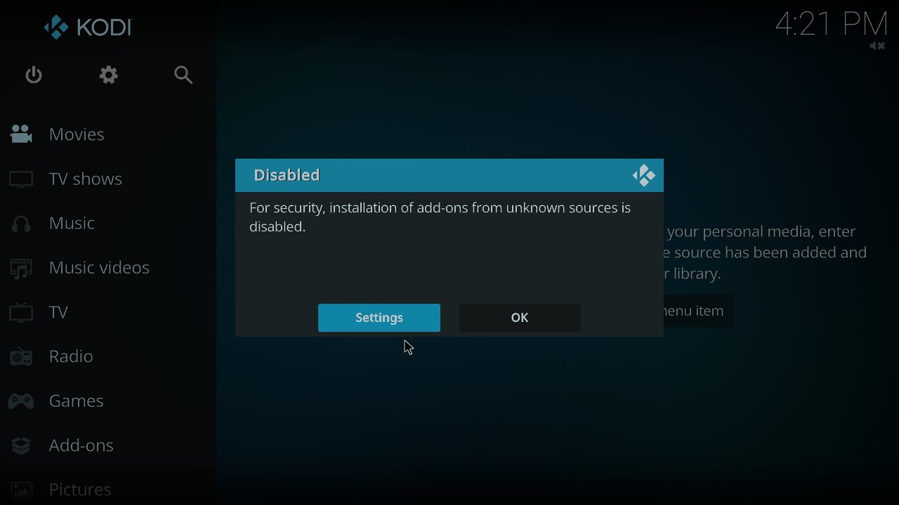

Turn on **Unknown sources**:

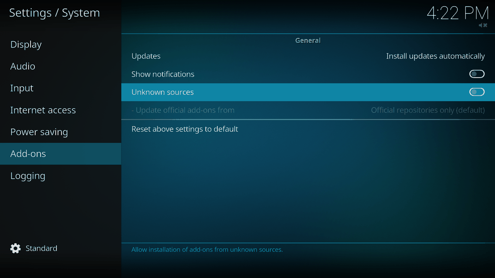

Kodi shows a warning. Choose **Yes**, then go back to the Add-ons screen:

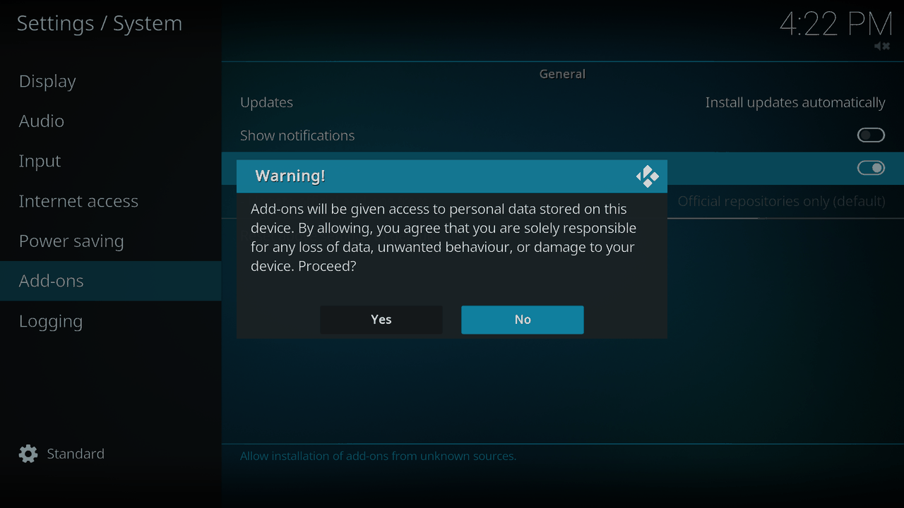

### 3. Install the zip

Choose **Install from zip file**:

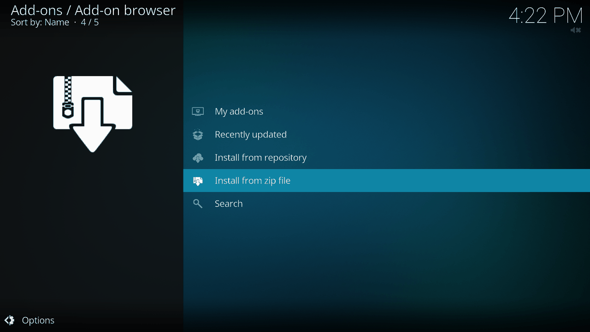

Find the folder you downloaded to and choose the zip:

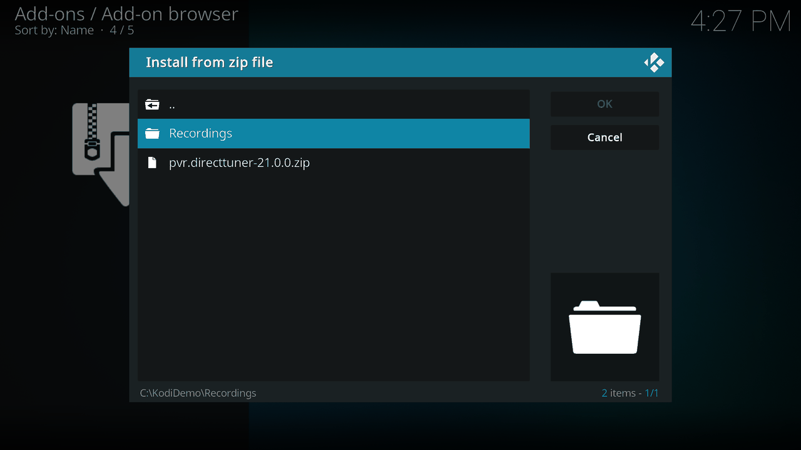

After a few seconds Kodi shows **Add-on installed**:

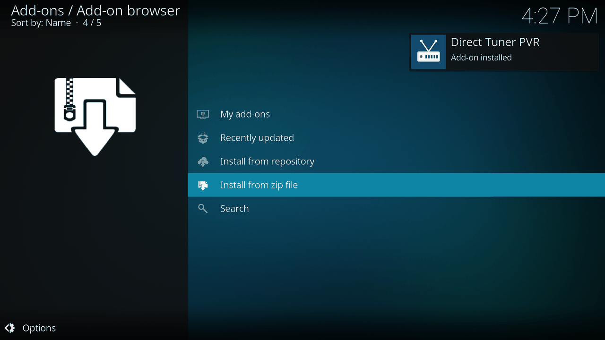

That's all the setup most people need. The add-on finds your tuner by itself and loads the channels and
guide. Open **TV** on Kodi's main menu to watch.

### 4. If you use another PVR add-on

Kodi would show both add-ons' channels, so turn the old one off. This disables it without deleting it,
so you can go back at any time.

1. Go to **Add-ons** > open box icon > **My add-ons** > **PVR clients**.
2. Choose the old add-on, such as NextPVR, and then **Disable**.
3. Restart Kodi.

To switch back, enable the old add-on and disable Direct Tuner PVR the same way. This is also where you
open the add-on's settings, with **Configure**:

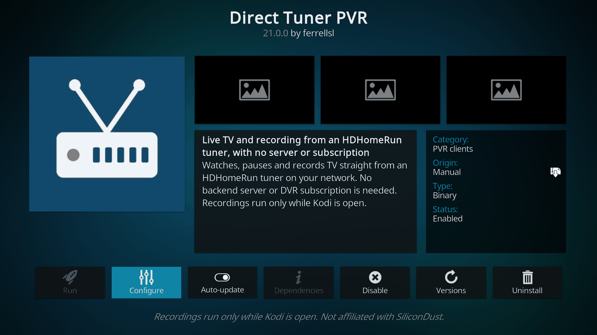

### 5. Optional: show the tuner's channel numbers

Kodi numbers channels 1, 2, 3 by default. To see the real numbers, such as 3.1 and 5.1:

1. Go to **Settings** > **PVR & Live TV** > **Channels**.
2. Set the level at the bottom left to **Advanced**.
3. Turn on **Use channel numbers from backend**.
4. Restart Kodi.

## Settings

Everything here is optional. Open the settings with **Configure**, as shown above.

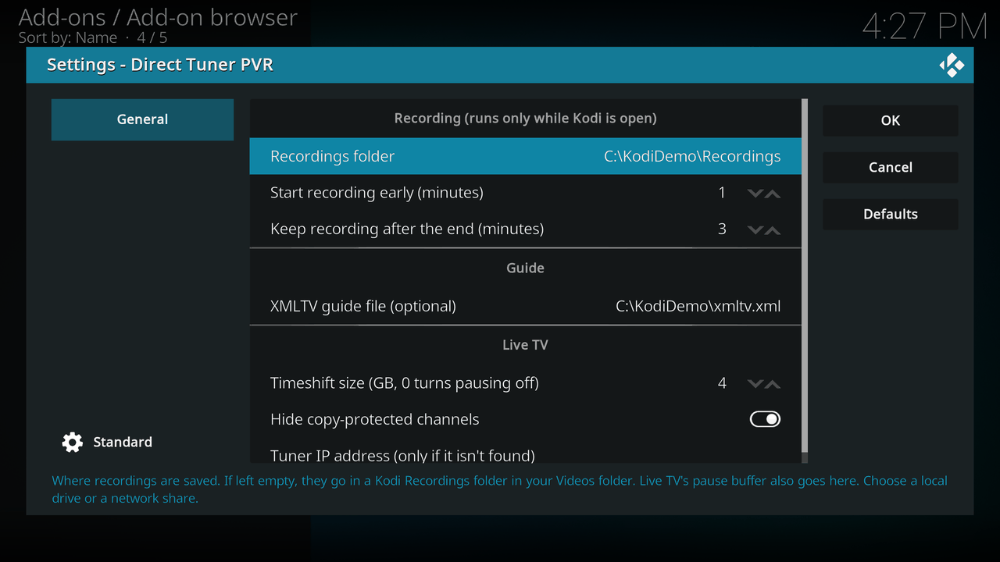

| Setting | What it does |
|---|---|
| **Recordings folder** | Where recordings are saved. If left empty, they go in `Kodi Recordings` in your Videos folder. |
| **Start recording early** | Minutes to start before a show. Default 1. |
| **Keep recording after the end** | Minutes to keep going after a show. Default 3. |
| **XMLTV guide file** | An optional guide file. See [Guide](#guide). |
| **Timeshift size** | How much live TV is kept on disk for pausing and rewinding. About 2 GB holds 15 minutes of HD. 0 turns pausing off. Default 4 GB. |
| **Hide copy-protected channels** | Hides DRM channels, which can't play. On by default. |
| **Tuner IP address** | Only needed if the tuner isn't found, for example on another subnet. Enter an address like `192.168.1.50`. |

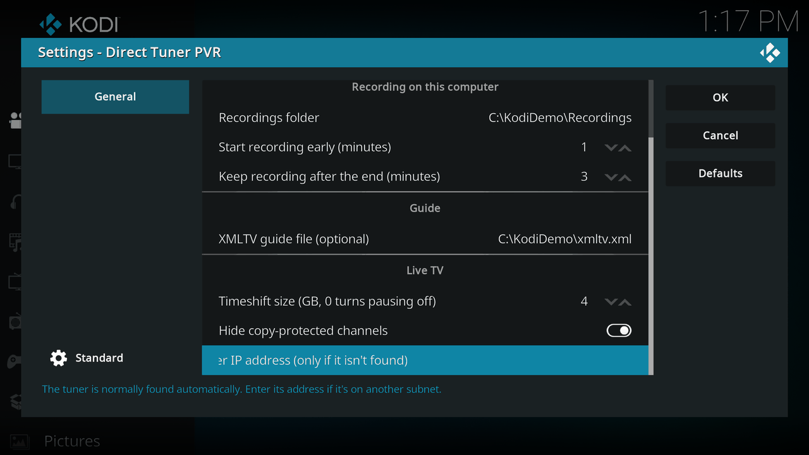

Kodi restarts the add-on when you change most settings, which stops any recording in progress.

## Guide

**With no setup,** the guide comes from SiliconDust through your tuner. It covers about 2 days and needs
no subscription.

**With an XMLTV file,** choose the file in the settings if you already make one, for example with
zap2xml. The file is used for every channel it covers, and the built-in guide fills in the rest. The
add-on matches channels by the number in a channel's display name. ATSC 3.0 channels numbered 100 and up
also match that number minus 100, so 103.1 uses the listings for 3.1. The add-on rereads the file when
it changes.

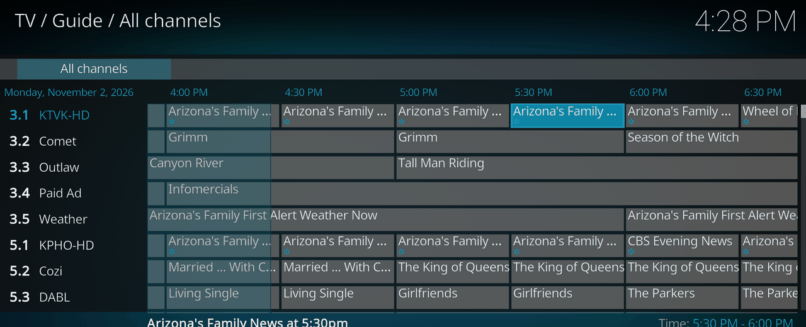

## Recording

### One show

In the **Guide**, choose a show and then **Record**:

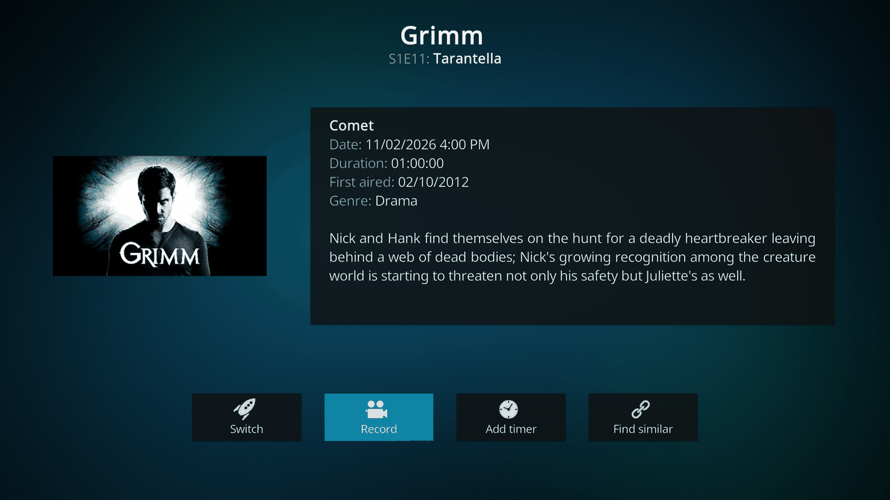

### A series, or a custom time

Choose **Add timer** instead. For a show in the guide, the type starts as **Series (guide)**. You can
change it to **One time (guide)** with **Type**.

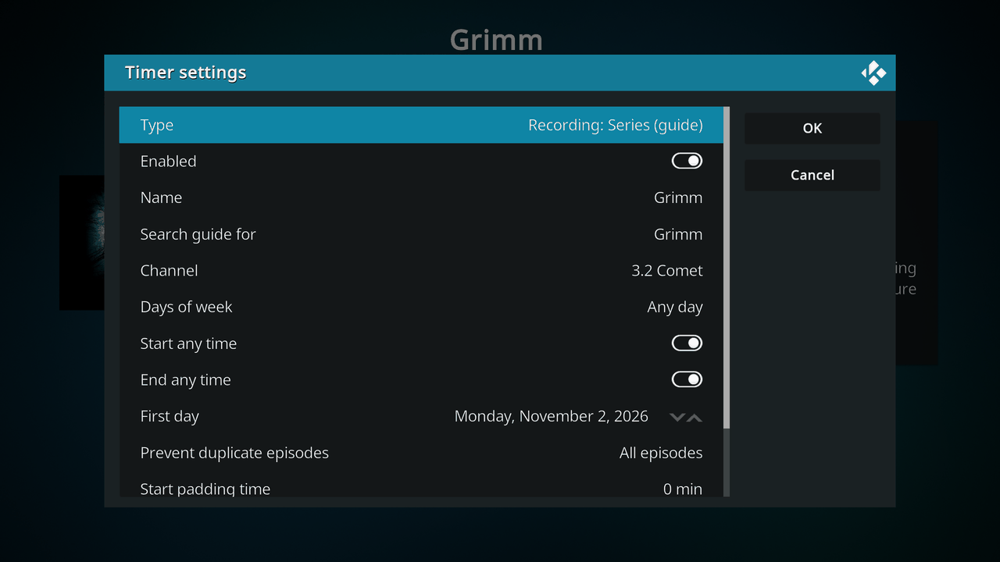

Scroll down for the rest. Useful settings for a series:

- **Channel:** choose any channel to find the show wherever it airs.
- **Days of week** and **Start any time:** limit when it records.
- **Prevent duplicate episodes:** choose **New episodes only** to skip repeats.
- **Max recordings:** keeps only the newest ones and deletes older recordings of that series.

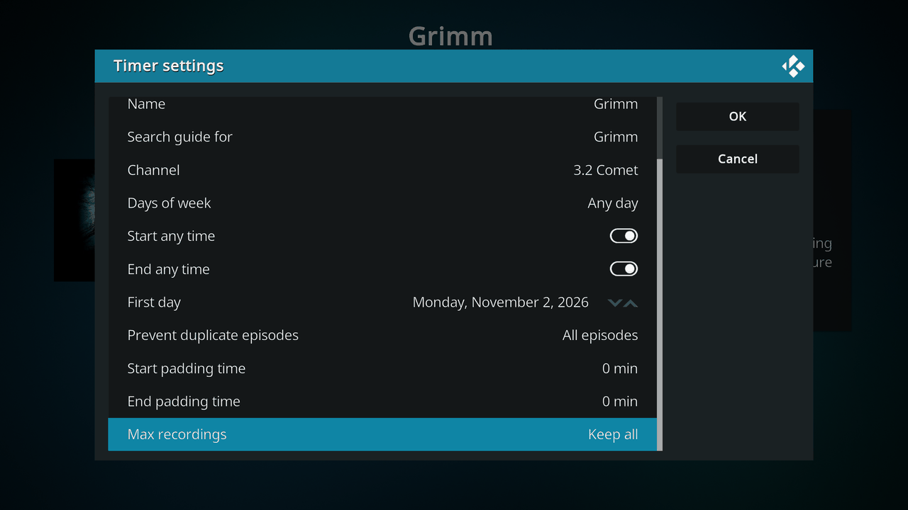

Leave the padding times at 0 to use the add-on's own early and late minutes.

To record at a set time with no guide entry, go to **TV** > **Timers** > **Add timer**.

### Timers and recordings

**TV** > **Timers** lists what's coming up. A series shows each airing, and you can delete one episode
without changing the series. Kodi marks a timer that failed or has no free tuner for it.

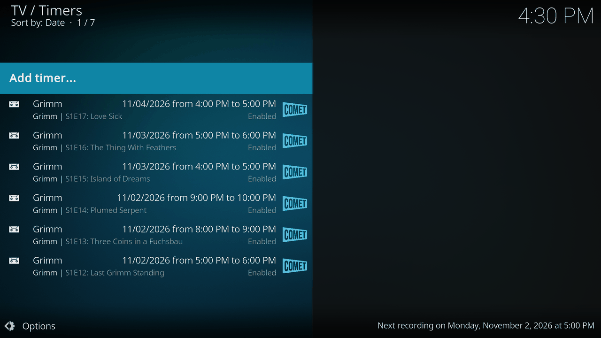

**TV** > **Recordings** lists what you've recorded. You can play a show while it's still recording.
Open a recording's context menu to delete it, which removes the file.

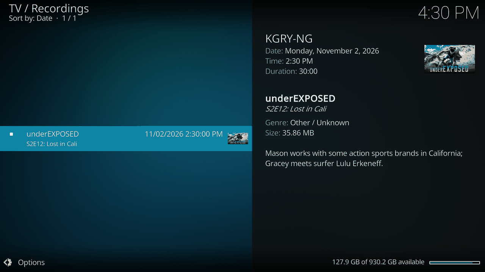

Each recording is a `.ts` file with a `.json` file of the same name beside it.

## Known limits

- **Recordings run only while Kodi is open.** Close Kodi during a recording and it stops. If you reopen
  Kodi before the show ends, recording carries on in a second file. Kodi must also stay awake, so set
  your PC not to sleep.
- **A recording takes priority over live TV.** If every tuner is busy, a recording stops whatever live TV
  you're watching. Watching and recording the same channel uses only one tuner.
- **"Play recording / Switch to channel".** Kodi asks this when you open a channel that's recording. It's
  a normal Kodi message: choose **Switch to channel** for live TV.
- **AC-4 channels take about 15 seconds to start.**
- **Seeking across a signal dropout is inexact.** If the signal dropped while you were watching, rewinding
  past that point can land several seconds away from where you aimed.
- **"No signal on this channel"** means the tuner couldn't lock on. It's a reception problem. ATSC 3.0
  usually needs a stronger signal than ATSC 1.0.
- **One tuner device at a time.** If you have more than one, enter the address of the one to use.
- **Network folders aren't tested yet.** A recordings folder on a network share should work, but a local
  drive is the safe choice for now.

## Reporting a problem

Please [open an issue](https://github.com/ferrellsl/Direct-Tuner-PVR/issues) with:

- Your Kodi version, and whether it's standard Kodi or the AC-4 build.
- Your tuner model.
- What you did, what you expected, and what happened.
- The relevant part of `kodi.log`, which is in `%APPDATA%\Kodi`.

**Before sharing a log, search it for `DeviceAuth` and remove the value.** It identifies your tuner to
SiliconDust, and Kodi's own logging can include it in the guide's web address, especially with debug
logging on. Also check the log for anything else you'd rather keep private, such as your user name in
folder paths.

## Build from source

You need Visual Studio 2022, CMake, Ninja and a Kodi 21 source tree for the add-on headers.

```
powershell tools\build.ps1 -Package -KodiInclude <kodi source>\xbmc\addons\kodi-dev-kit\include
```

The zip goes in `dist`. `build\directtuner_tests.exe` tests the core with no Kodi or tuner, and
`build\directtuner_tool.exe` tries it against a real tuner. `src/core` has no Kodi types in it.

## License and credits

GPL-2.0-or-later. See [LICENSE.md](LICENSE.md).

This add-on uses the approach of the GPL add-ons pvr.hdhomerun and pvr.nextpvr.

Direct Tuner PVR is an independent project. It isn't affiliated with or endorsed by SiliconDust, Team
Kodi or NextPVR. HDHomeRun is a trademark of SiliconDust USA Inc., and Kodi is a trademark of the XBMC
Foundation.
